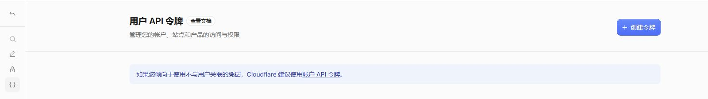
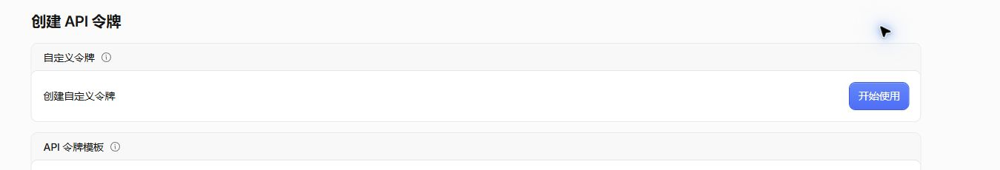
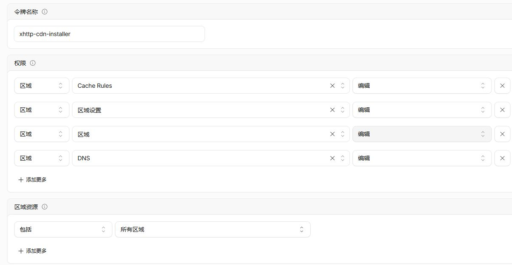
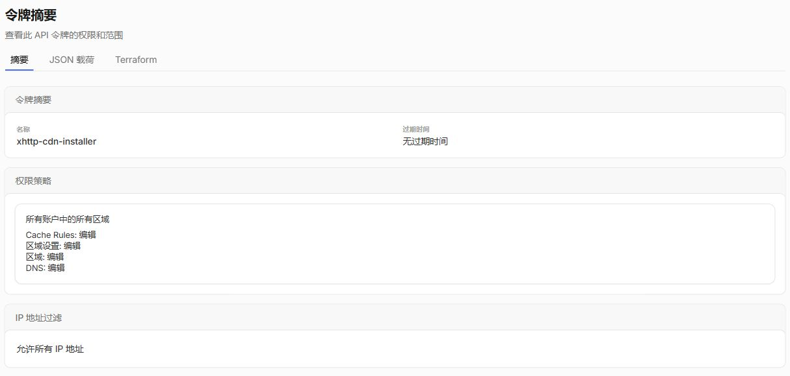
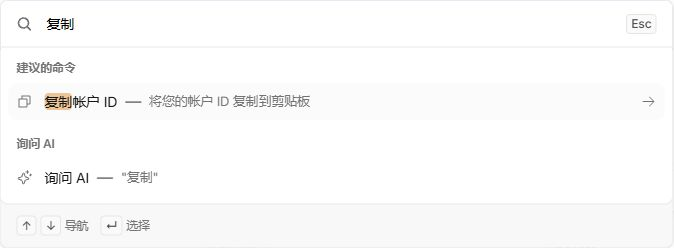

# Cloudflare API Token 与 Account ID 图文教程

适用于本仓库的 XHTTP + Cloudflare + ECH 安装器。截图取自 Cloudflare 中文后台，界面名称可能随版本变化。

图片只保留操作区域；真实 Account ID、Zone ID、邮箱、域名及 Token 值均不展示。不要将实际凭据写进仓库、Issue 或截图。

## 1. 进入用户 API 令牌页面

登录 Cloudflare，打开[用户 API 令牌页面](https://dash.cloudflare.com/profile/api-tokens)，点击右上方“创建令牌”。也可以从头像 → 我的个人资料 → API 令牌进入。

本教程使用 **API Token**，不要复制页面下方的 **Global API Key**。本脚本不支持“邮箱 + Global API Key”的认证方式。

## 2. 选择自定义令牌

在“自定义令牌”区域点击“开始使用”。仅使用“编辑区域 DNS”模板的默认权限不够，需要以下四项权限。

## 3. 配置权限和资源范围

本教程演示**完整自动安装，包括自动添加尚未接入 CF 的域名**。名称可填写 `xhttp-cdn-installer`。通过“添加更多”配置四行，顺序不限：

| 资源 | 权限 | 权限级别 |
|---|---|---|
| 区域（Zone） | 区域（Zone） | 编辑（Edit） |
| 区域（Zone） | DNS | 编辑（Edit） |
| 区域（Zone） | 区域设置（Zone Settings） | 编辑（Edit） |
| 区域（Zone） | Cache Rules | 编辑（Edit） |

“区域资源”根据是否需要创建新区域选择：

- **需要脚本添加新域名或跨域名复用：包括 → 所有区域**。下图演示此选项；资源范围必须覆盖目标账户的新区域，不能只授权一个已有区域。Token 可以管理授权范围内的区域、DNS、区域设置和缓存规则，并不等于拥有所有 Cloudflare 产品权限。
- **域名已加入 CF，只部署一个域名：包括 → 特定区域 → 要部署的根域名**。此时第一行可缩小为“区域 → 区域 → 读取”，其余三行仍为编辑；这组较小权限不用于自动添加新域名。

有效期和客户端 IP 过滤按实际使用需要设置。下方摘要演示“无过期时间、不限制来源 IP”，不是强制要求。若限制来源 IP，要填写调用 API 的 VPS 出口地址；若 Token 过期或被撤销，使用它的证书自动续期也会失败。

仅有“区域 → 区域 → 读取”不能满足本教程的自动添加区域流程。Account ID 本身不会增加权限；若账户策略不允许创建区域，可先在 CF 手动添加域名，再使用上述单域名较小权限方案。

## 4. 核对摘要，创建并保存 Token

点击“继续以显示摘要”，核对权限与范围后点击“创建令牌”。下图为已有 Token 的只读摘要，展示需要核对的内容，不包含 Token 值。

新 Token 的值只在创建完成时展示一次，请自行保存。运行脚本时将其粘贴到隐藏输入提示中即可，不要粘贴到 GitHub、公开聊天或 shell 命令参数中。

可选的续期专用 Token 只需目标域名的 Zone / Read 和 DNS / Edit；若安装时提供该 Token，脚本只持久保存续期 Token。它通常不能代替安装 Token 执行完整卸载。

## 5. 查看和复制 Account ID

Account ID 是账户标识，**不是 API Token，也不是 Zone ID**。同一账户的不同域名共用 Account ID，各域名的 Zone ID 不同。

在 Cloudflare 后台：

1. 进入目标账户的主页。
2. 按 **Ctrl + K**（macOS 使用 **Command + K**），或点击“快速搜索”。
3. 中文界面输入 **复制**，选择 **复制帐户 ID — 将您的帐户 ID 复制到剪贴板**。英文界面可搜索 `Copy account ID`。
4. 将复制的 32 位 Account ID 粘贴到脚本提示处。

下图只展示复制入口，不显示真实 ID，也不包含带账户 ID 的浏览器地址栏或个人账户信息。

另一个入口：进入任意域名的“概述”，在页面下方 API 区域复制 Account ID；不要误复制旁边的 Zone ID。也可在 Workers & Pages 的 Account Details 中查找。[Cloudflare 官方说明](https://developers.cloudflare.com/fundamentals/account/find-account-and-zone-ids/)

## 6. 哪些情况需要 Account ID

- **域名已添加到 CF，Token 能查询到正确根域名**：脚本自动读取区域信息，不要求输入 Account ID。
- **查询不到区域，准备自动创建**：脚本要求 Account ID，用来指定创建区域的账户；同时需要相应创建权限。
- **域名已添加但脚本仍询问**：先核对输入的是根域名、Token 的账户和区域范围是否正确，不要用另一个账户的 ID 继续创建。

域名已在 CF、仅缺少节点子域名时，无需重新创建整个区域。输入一个该根域名下的新节点名称，由脚本添加代理 A 记录即可。

[返回 README](../README.md)
